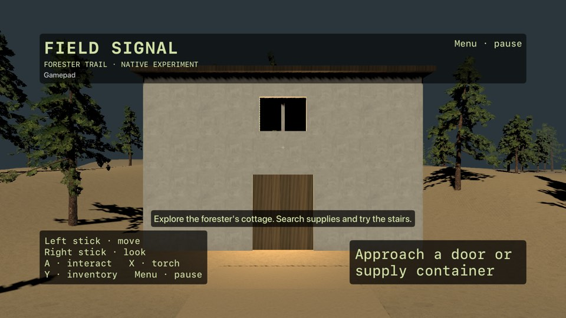

# Actual phase 2 simulator captures

Source `a82d77adee71e50613afb6caf9835b5196750fdf`, native CI
https://github.com/thundercato/bunker-game/actions/runs/42503185166 .
Both jobs green; 16 tests per platform, unsigned install/launch/capture.

[iPad landscape view](ipad-landscape.jpg) / [raw framebuffer](ipad-raw.jpg).
The display copy adds EXIF orientation8 only; JPEG pixel data is unchanged. Some
viewers ignore EXIF and show the raw portrait framebuffer sideways. These are
real native SceneKit captures, not generated artwork or physical-device footage.

[Exact instrumented metrics](performance.json) were read from the launched apps'
private Documents directories after an eight-second stationary capture. They
measure source setup, callback cadence, CPU update and resident memory, not GPU
presented frames, peak memory, physical-device FPS or a sustained gameplay route.
PNG and xcresult UI attachments remain in Actions artifacts for14days; smaller
JPEGs travelled in the existing log markers because cloud artifact redirects
were unavailable. Source texture/model provenance remains in NativeContent and
the phase2 note. No scene content was edited after capture.
